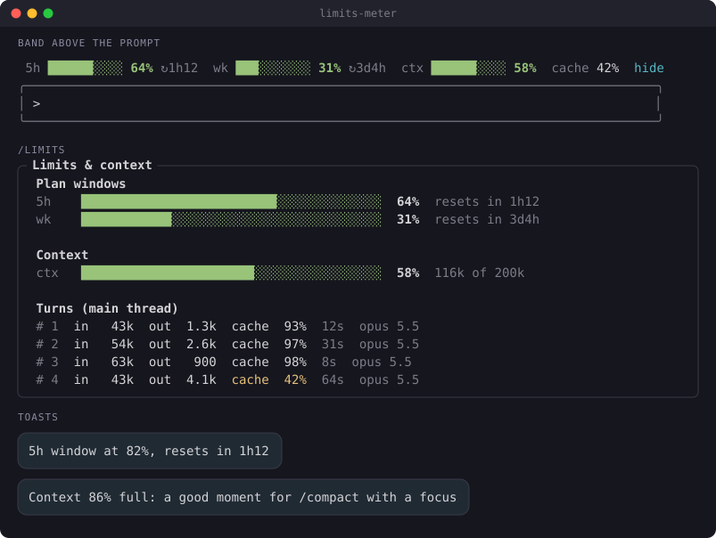
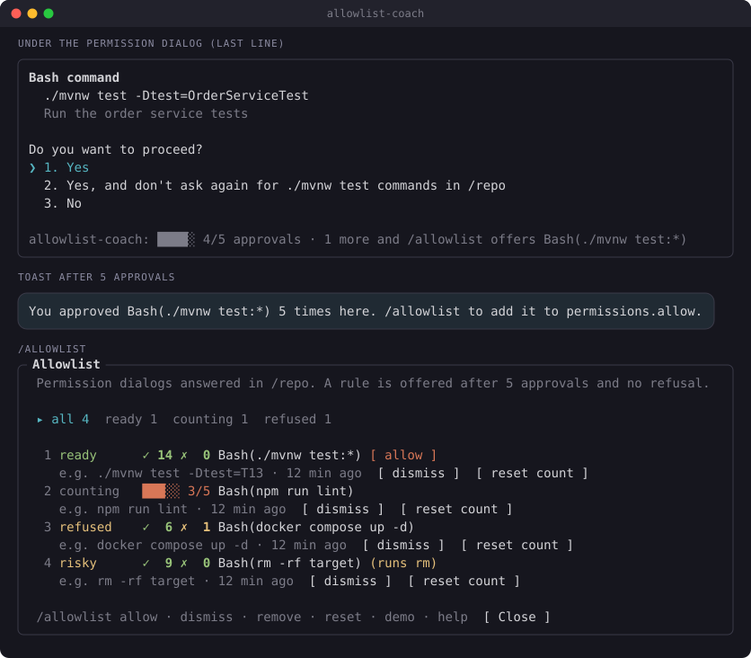
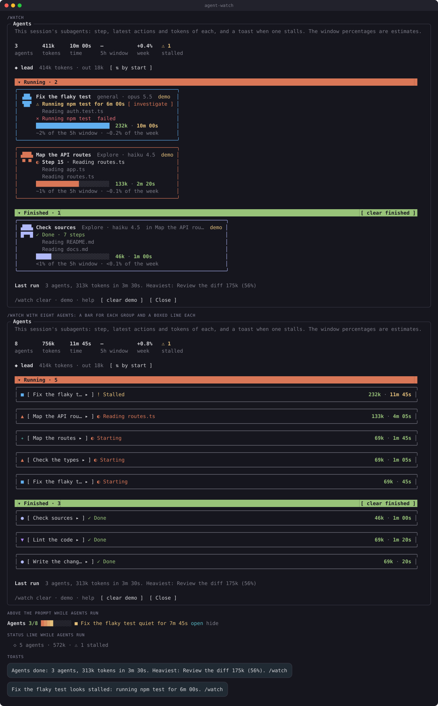
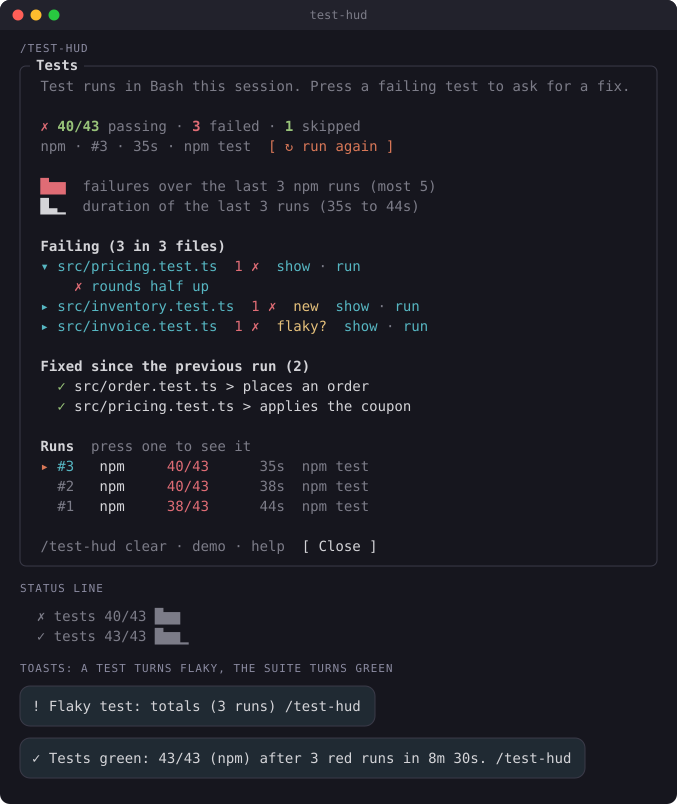
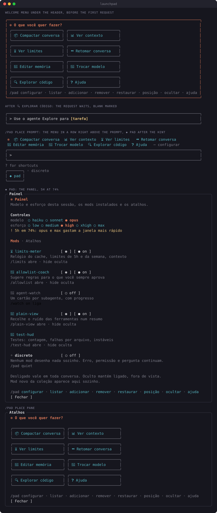
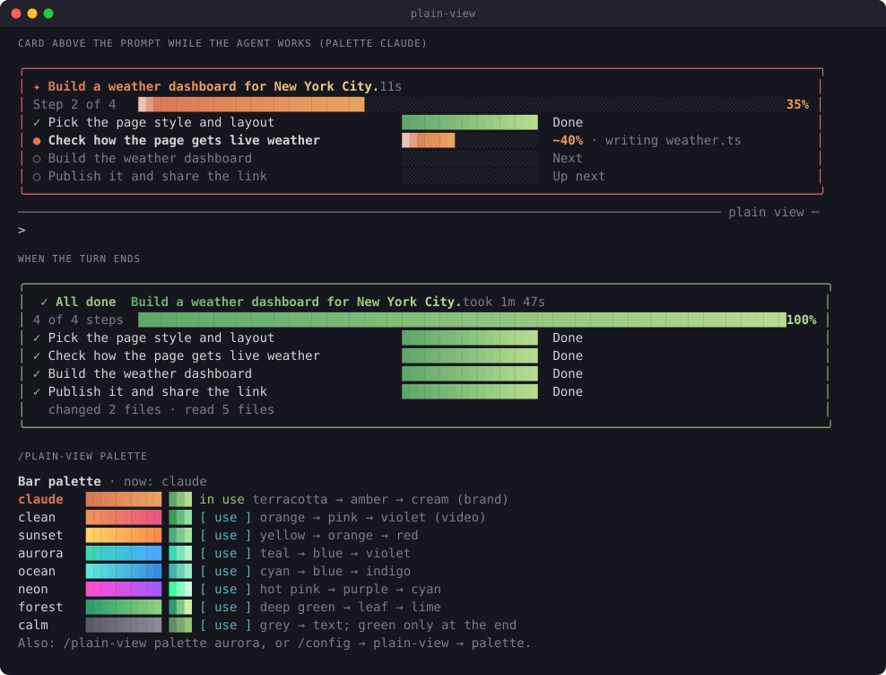

# Claude Code mods

**English** | [Português (Brasil)](README.pt-BR.md)

[](https://github.com/ice-lfernandes/claude-code-mods/actions/workflows/ci.yml)
[](https://github.com/ice-lfernandes/claude-code-mods/releases/latest)
[](#install)
[](LICENSE)

**Your plan limits, your context and what the agent is doing, right above the prompt.** Six
mods for Claude Code, installed from one marketplace.


limits-meter through a request, the `/limits` pane and a costly switch near the limit
([mp4](screenshots/limits-meter-demo.mp4)). Drawn from the mod's real output by
`scripts/screenshots/limits-meter-demo.sh`.

Mods for everyday Claude Code UX. A mod is a Claude Code plugin made of function hooks: it can
draw a band above the prompt, a pane, a status line entry or a toast. Requires Claude Code
2.1.287 or later.

| Mod | Command | What it does |
| --- | --- | --- |
| [limits-meter](limits-meter/) | `/limits` | Plan limits, cache clock and context above the prompt: model and effort, 5-hour and weekly windows with reset times, a countdown of the prompt cache with an opt-in keep-warm that spends plan, context split by group (system, MCP, messages), tokens per turn, and a toast on a costly model switch near the limit |
| [allowlist-coach](allowlist-coach/) | `/allowlist` | Counts permission dialogs per rule; after 5 approvals with no refusal, offers to add the rule to `permissions.allow`, asking before it writes |
| [agent-watch](agent-watch/) | `/watch` | Subagents at a glance: a card per agent with its mascot, step and tokens, a band above the prompt, a toast when one stalls, and a summary naming the heaviest agent when they finish |
| [test-hud](test-hud/) | `/test-hud` | Test runs at a glance: passing over total on the hint line under the prompt, colored by the result, a sparkline of failures across runs, the failing tests grouped by file, and toasts when the suite turns green or a test turns flaky |
| [launchpad](launchpad/) | `/pad` | A menu of one-click actions under the header, above the prompt or in a pane: each button runs an installed command, skill or agent. `◆ pad` opens a control panel: model and effort in one click, this collection's mods, the shortcuts. Pick and order up to 8 in `/pad configuration`, or ship a team's in the repository |
| [plain-view](plain-view/) | `/plain-view` | A quiet transcript: tool rows step aside and the agent's plan shows as a card above the prompt, with the current step, progress bars and a summary when the turn ends |

## Using the mods

The images below are drawn from each mod's real output: `scripts/screenshots/run.sh` drives the
mod with sample data through `claude plugin test` and renders what it drew.

Every mod answers to the same four words, besides its own commands: `/x on` and `/x off` turn it
on and off in every conversation (the `enabled` option, the same as in `/config`; off keeps only
the command, so `/x on` can bring it back), and `/x hide` and `/x show` keep it on but take away
what it draws on its own (the band, the toasts, the status line, the card). The pane and the
command still open. `/x help` lists the rest. A mod's `hide` comes back in the next session.

### limits-meter

The band shows on its own after the first response. Commands:

```
/limits          open the pane: plan windows, context in tokens, the last 20 turns
/limits hide     hide the band above the prompt, in later sessions too
/limits show     bring the band back
/limits off | on  turn the mod off or on in every conversation
/limits keep-warm on|off  keep the prompt cache warm (asks first, spends plan)
/limits warn N   warn on a costly switch with the 5-hour window from N% (default 70)
/limits help     list the commands
```

The band leads with the model and effort; `format: compact` draws it as one line of numbers.
From 85% context the band and the pane show `compact`, which puts `/compact [focus]` in the
prompt and runs nothing. `details` on the band opens the pane. The pane also says when a window
reaches 100% at the current pace, before it resets, and draws the context fill turn by turn.
A switch to a bigger model (haiku < sonnet < opus < fable) or to effort `max` with the 5-hour
window at 70% or more shows one toast with the minutes left at the pace of the last 3 turns.

The `cache` cell counts down the prompt cache (`⏱ 52:10`), turns to the warning color in its last
10 minutes (the last minute of a 5-minute cache) and to `❄ cold` once it lapses, with one toast.
It needs the cache TTL, which the engine gives on a model switch and which the mod otherwise
reads from a one-request turn after a pause; until it knows, the cell keeps the last turn's hit
rate. `keep warm` (or `/limits keep-warm on`) asks first, then sends one short message just
before the cache goes cold, a real turn drawn as one dim row. It stops at your next prompt or
after 2 hours. It spends plan: that is the only way this mod calls a model, and only when you
turn it on. The context bar is split by the engine's categories (system, MCP, messages), with a
legend under the band; the pane lists each category and each MCP server.



**The cache clock and keep warm** ([mp4](screenshots/limits-meter-cache.mp4)): the countdown after a reply, the context bar by group, the `/limits` pane, and keep warm pinging before the cache goes cold. Drawn from the mod's real output by `scripts/screenshots/limits-meter-demo.sh`.


#### Install

```
/plugin install limits-meter --marketplace ice-lfernandes/claude-code-mods
```

Or for one session, from a clone: `claude --plugin-dir ./limits-meter`.

### allowlist-coach

It counts on its own each time you answer a permission dialog. Commands:

```
/allowlist             open the pane: every counted rule, numbered, ready ones first
/allowlist allow 1     add rule 1 to permissions.allow (asks first, and which file)
/allowlist dismiss 2   stop offering rule 2
/allowlist remove 1    take rule 1 back out of allow, when the coach added it (asks first)
/allowlist reset 2     set rule 2's count back to zero (asks first)
/allowlist reset       clear this project's counts (asks first)
/allowlist demo        the pane with sample rules; nothing is read or written (demo off exits)
/allowlist hide        keep counting, with no toast or note in the dialog
/allowlist show        bring them back
/allowlist off | on    turn the mod off or on in every conversation
/allowlist help        list the commands
```

The pane has tabs by status, a filter, and a scrolling list. A risky rule says why it is never
offered.



#### Install

```
/plugin install allowlist-coach --marketplace ice-lfernandes/claude-code-mods
```

Or for one session, from a clone: `claude --plugin-dir ./allowlist-coach`.

### agent-watch

The band above the prompt, the status line and the toasts show on their own while subagents run. Commands:

```
/watch              open the pane: a card per agent with step, latest actions and tokens
/watch demo         add three fake agents, one of them stalled, to see the pane
/watch clear        drop finished and demo agents
/watch clear done   drop finished agents only
/watch clear demo   drop demo agents only
/watch hide         keep tracking, with no toast or status line
/watch show         bring them back
/watch off | on     turn the mod off or on in every conversation
/watch help         list the commands
```

Each agent has a card with its mascot and color, its step, the two calls before it, a bar of its
tokens against the heaviest agent's, and an estimate of its share of the 5-hour window and of the
week. The cards sit in two groups, Running and Finished; a bar across the pane folds its group. From
five agents (the `compactAt` option) each is one boxed line, and its name opens the card. A stalled agent has
an `investigate` button that asks about it in the prompt.



#### Install

```
/plugin install agent-watch --marketplace ice-lfernandes/claude-code-mods
```

Or for one session, from a clone: `claude --plugin-dir ./agent-watch`.

### test-hud

The tests line (atop the hint line under the prompt, red, yellow or green by the result) and the
toasts show on their own each time a test runner runs in Bash. Commands:

```
/test-hud           open the pane: last run, failing tests (new ones marked), fixed tests,
                    sparkline, last 10 runs
/test-hud demo      add six fake runs that go from red to green
/test-hud clear     drop the runs
/test-hud hide      keep counting, with no tests line or toast
/test-hud show      bring them back
/test-hud off | on  turn the mod off or on in every conversation
/test-hud help      list the commands
```

In the pane, failing tests come grouped by file (a class for Maven and Gradle, a suite for jest and
bun, a module for cargo; go and rspec stay a flat list). The first group is open; press a header to
open or close one. `show` puts the file in the prompt (`@src/a.test.ts`), only where the group is a
real path (vitest, pytest); `run` asks for only that group's tests with the same runner. Press a
failing test to ask Claude for a fix, or `run again` to ask for the same command: all of them put
the request in the prompt and run nothing. Press a run in the list to see it; failing tests that
failed, passed and failed again are marked `flaky?`, and one toast names them, once per test
(`flakyToast` option, on by default). With the `keepHistory` option the runs carry over to the next
session in the same project.



#### Install

```
/plugin install test-hud --marketplace ice-lfernandes/claude-code-mods
```

Or for one session, from a clone: `claude --plugin-dir ./test-hud`.

### launchpad

The menu shows on its own when a session starts and after `/clear`, until the first prompt.
`◆ pad`, under the hint line below the prompt, opens the control panel: the session's
model and effort as buttons (a press runs `/model` or `/effort`; `opus` and `max` turn yellow
when the 5-hour window passes 70%), then two tabs: Mods, a switchboard with a toggle (`/x on` and
`off`) and an eye (`/x hide` and `show`) for each mod of this collection, and the shortcuts.
The labels follow the `language` option. Commands:

```
/pad                                        show the menu again
/pad panel                                  open the control panel, as ◆ pad does
/pad configuration                          pane to order, remove and add buttons, up to 8, and the mods to install
/pad list                                   every button with what it runs
/pad add 🔎 Revisão | /code-review          add a button for an installed command, skill or @agent
/pad remove 3                               drop button 3
/pad reset                                  back to the defaults
/pad place header | prompt | pane           where the menu shows: under the header, right above the prompt, or in a pane
/pad hide | show                            hide the menu or show it again
/pad off | on                               turn the launchpad off or back on in every conversation
/pad quiet [on | off]                       quiet mode: no mod draws anything by itself; a chip on the hint line brings it back
```



#### Install

```
/plugin install launchpad --marketplace ice-lfernandes/claude-code-mods
```

Or for one session, from a clone: `claude --plugin-dir ./launchpad`.

### plain-view

Off until you turn it on (`/plain-view on`, the `enabled` option, or the switch in launchpad's
panel). While it is on, the transcript keeps the conversation and drops the tool rows that
worked; a failed or interrupted call, a permission dialog and the agent's questions always draw
in full. Above the prompt, a card follows the request: its title, `Step 2 of 4` with a bar, one
row per task of the agent's list with its own bar (`Done`, `~40%` for the current step, `Next`,
`Up next`). The current step's percentage is an estimate from its tool calls, hence the `~`.
When the turn ends the card turns green with the time it took and the files changed and read,
or grey on Esc; the next request starts a fresh one, and `[-]` folds it.
The agents the main turn hands work to show in one row of the card (`◇ 1 agent running ·
code-review · 3m 12s`, with agent-watch's `/watch` when it is installed, and agent-watch's band
message under it: `└ Agents 0/3 ░░░░░░░░░░ · ▲ Pre-outline · Writing pre-outline.md`), and with no task list
the card waits for them (`Waiting for 1 agent`). A turn with no list that called tools or agents
ends in a small green card (`✓ Done`, the time, the files and the agents); a plain conversation
leaves none.

Three options shape what you see, all in `/config`:

- `agentText`, what stays of the agent's messages: `final` (default: the messages written before
  a tool call step aside, the final answer stays), `none`, `card` (the answer's first sentence in the end card) or
  `all`. Failures, permission dialogs and the agent's questions always show. The agent's
  thinking is drawn outside any mod's reach; `"showThinkingSummaries": false` in
  `~/.claude/settings.json` hides it everywhere, ctrl+o included.
- `askForTasks` (on by default): one line in the system prompt asks the model to keep a task
  list for work of more than two steps, or a checklist in its reply when the session has no task
  tool, so the card shows each step; a few tokens per request. When a checklist in the text stops
  moving, the card says `list not updated` and the model gets a short reminder with a tool result.
  Off, the card reads the list the agent keeps on its own, or a checklist in its answer.
- `request`, how much of a request of several lines the card's title shows: `line` (default: the
  first line and `+5 lines`), `joined`, `auto` (the first line of prose) or `all`. The card's
  `show request` button unfolds the whole request.

```
/plain-view                   the settings pane: every option in three tabs, one click each
/plain-view on | off          show or hide the card and the tool rows
/plain-view hide | show       keep the rows folded, without the card above the prompt
/plain-view demo              a sample plan in the card for 12 seconds
/plain-view palette           the 8 bar palettes with a sample, and a button to switch
/plain-view palette aurora    switch to one by name
/plain-view help              list the commands
```

The bars are a gradient of the `palette` option's colors (default `claude`) with a shine that
runs while the agent works. Each palette has a dark and a light set, picked by your theme.
`animation: off` keeps the bars still, in the theme's own colors.



Four short scenarios, each drawn by the mod itself:

**A task list** ([mp4](screenshots/plain-view-tasks.mp4))


**No task tool: a checklist in the answer** ([mp4](screenshots/plain-view-checklist.mp4))


**Esc interrupts the turn** ([mp4](screenshots/plain-view-interrupted.mp4))


**A background agent** ([mp4](screenshots/plain-view-agents.mp4))


#### Install

```
/plugin install plain-view --marketplace ice-lfernandes/claude-code-mods
```

Or for one session, from a clone: `claude --plugin-dir ./plain-view`.

## Install

Each mod's section above has its own install line. In a Claude Code terminal session:

```
/plugin install limits-meter --marketplace ice-lfernandes/claude-code-mods
```

Answer `y` to add the marketplace, then pick a scope.

To try a mod for one session from a clone:

```bash
claude --plugin-dir ./limits-meter
```

## What each mod reaches

A mod runs inside Claude Code with your permissions and is not sandboxed. Read it before you
load it, and run `claude plugin validate <folder>` to list every event it hooks and every call
it makes.

| Mod | Network | Runs processes | Files | Calls a model | Sends data anywhere |
| --- | --- | --- | --- | --- | --- |
| limits-meter | No | No | No (`on` and `off` write its own option through `/config`) | Only if you turn on keep-warm: one short message per cache lap, until your next prompt or 2 hours | No |
| allowlist-coach | No | No | Reads and writes `.claude/settings.local.json`, or `.claude/settings.json` when you pick it, after you confirm. `on` and `off` write its own option through `/config` | No | No |
| agent-watch | No | No | No (`on` and `off` write its own option through `/config`) | No | No |
| test-hud | No | No | Reads Bash's saved copy of an output too long to show whole. `on` and `off` write its own option through `/config` | No | No |
| launchpad | No | No | Reads `.claude/launchpad.json` and the agent files in `.claude/agents/`, in the project and in your home folder. `on` and `off` write its own option through `/config` | No | No |
| plain-view | No | No | No (writes its own options through `/config` when you run `on`, `off` or `palette`, or press one in its settings pane) | No | No |

## Developing

```bash
claude plugin validate ./limits-meter
claude plugin test ./limits-meter
claude plugin validate ./allowlist-coach
claude plugin test ./allowlist-coach
claude plugin validate ./agent-watch
claude plugin test ./agent-watch
claude plugin validate ./test-hud
claude plugin test ./test-hud
claude plugin validate ./launchpad
claude plugin test ./launchpad
claude plugin validate ./plain-view
claude plugin test ./plain-view
```

Every mod ships tests, including a render test on the `terminal` and `desktop` surfaces.

### Checks before a merge

GitHub Actions (`.github/workflows/ci.yml`) runs on every pull request and every push to `main`,
with no Claude login and no model call:

- `claude plugin validate` and `claude plugin test` for each mod, on a pinned Claude Code version;
- `scripts/check-shared.sh`: the shared files are the same in every mod;
- `scripts/check-manifests.py`: every JSON file parses, the marketplace lists every mod, and each
  entry's name and description match the mod's `plugin.json`;
- `scripts/check-versions.sh <base>`: a mod changed in the pull request raised its version, since
  Claude Code updates an installed plugin only when the version moves;
- the screenshots match what the mods draw now (`scripts/screenshots/run.sh`, then no diff);
- `shellcheck` on the scripts.

Run the same checks locally before a push:

```bash
./scripts/check-shared.sh
python3 scripts/check-manifests.py
./scripts/check-versions.sh origin/main
./scripts/screenshots/run.sh && git diff --stat screenshots
```

### Shared helpers

A mod installs alone and cannot import another mod's code. The helpers every mod needs live in
`hooks/ui.tsx`, tested by `tests/ui.test.ts`, and both files are copies, the same in each mod:
language and icon style from the options, a prompt fill with its `[blank]` marked, the window of
a long list, a row of clickable verbs, and the number formats. Nothing in it takes `$`: the
engine follows `$` only into functions of the file that uses it, so the calls on `$` stay in
each mod's `register.tsx`. A mod that names tool calls also carries `hooks/phrases.ts` and
`tests/phrases.test.ts`: a tool call in a few words, in both languages (`reading routes.ts`,
`searching "invoice"`). Change one copy, copy it to the other mods, then check them:

```bash
./scripts/check-shared.sh
```

### Pane layout

Every pane follows the same outline, after launchpad's `/pad configuration`:

1. A dim hint on top: what the pane shows and where the figures come from.
2. Sections, each under a bold heading.
3. An empty state that names the next step (`/test-hud demo shows what this looks like`).
4. A footer: the command's verbs as clickable buttons (`/test-hud clear · demo · help`), then a
   close button.

A button that runs something from outside the mod, or undoes the person's data, puts the text in
the prompt instead of running it.

### Shared bands

Several mods can draw on the same line: `AbovePrompt` (limits-meter, plain-view, and launchpad
under `/pad place prompt`) and `PromptHint` (launchpad's `◆ pad`). Each `ui.render` hook there calls
`next(e)` and stacks its own row with what came back, never in its place, so every mod's row
shows:

- `AbovePrompt`: the mod's row first, the rows of the mods beneath it after. The one exception
  is launchpad, whose row goes last so it sits against the prompt box.
- `PromptHint`: the engine's hint first, the mod's row or button after.
- A mod with nothing to show, or switched off, returns `next(e)` as it is.

Otherwise the order between mods follows the order Claude Code loads them; a mod cannot set it.

After a change to what a mod draws, regenerate the images:

```bash
./scripts/screenshots/run.sh
```

## Custom mods, skills and agents

Need a mod, skill or agent built for your own workflow or team? I take on custom work: hooks,
panes, status lines, slash commands, skills and subagents for Claude Code.

- Email: [javacomia@gmail.com](mailto:javacomia@gmail.com)

## YouTube

My channel, **Java + AI**: [youtube.com/@JavaPlusAI](https://www.youtube.com/@JavaPlusAI)

## License

MIT. See [LICENSE](LICENSE).
